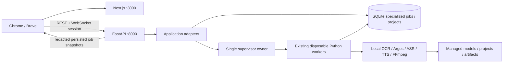

# W0 — Local Web architecture

Status: **PROPOSED**, backed by the **VERIFIED** source audit at develop `51f1283` and separate M5 `8ac209c`. No Web application exists yet. [Repository evidence](WEB_REPOSITORY_AUDIT.md).

## Decisions

1. Preserve root `app/` as the Python engine and existing Streamlit fallback. Add `apps/web/` and `apps/api/fashion_api/`; do not create a second importable package named `app` and do not move services into `engine/` during W1. The original plan's engine tree is a long-term boundary, not a prerequisite directory shuffle.
2. Next.js App Router + TypeScript, Tailwind, shadcn/ui, Zustand for transient editor state and TanStack Query for server state. The browser never reads SQLite, shell commands, model paths or provider credentials.
3. FastAPI + existing Pydantic v2 + synchronous SQLAlchemy repositories. Use short request-scoped sessions and dependency injection. Blocking filesystem/probe/read work goes to bounded thread execution; AI/render work always goes to durable specialized jobs and disposable subprocesses.
4. One API process with one supervisor owner, one Next process and at most one heavy AI/render/download workload per shared database. No Redis/Celery/PostgreSQL or multi-Uvicorn-worker deployment initially.
5. Keep SQLite and identifiers; project/segment/job/export UUIDs remain opaque strings. Keep existing specialized tables authoritative. A normalized API projection is not a replacement job database.
6. Loopback only: frontend `127.0.0.1:3000`, backend `127.0.0.1:8000`; browser talks directly to the exact backend origin, with an authenticated local session and CSRF protection. No unauthenticated Next proxy or public upload directory.
7. Existing storage is adopted only through an explicit configured data profile; W1 health starts without opening or migrating live SQLite. Fresh default future profile is `%LOCALAPPDATA%\FashionAI`, with stable project-relative paths retained.



## Incremental repository layout — PROPOSED

```text
app/                           existing engine, models, workers and Streamlit UI
apps/api/fashion_api/
  main.py                      app factory and lifespan
  core/                        configuration, local security, errors
  api/v1/                      thin routes
  schemas/                     explicit public DTOs
  services/                    adapters, job facade, storage profiles
  repositories/                only missing application operations
  workers/                     supervisor coordination, not new inference
apps/api/tests/                isolated API and security tests
apps/web/src/
  app/                         route layouts and pages
  components/{layout,feedback,media}/
  features/                    projects, OCR, review, editor, dubbing, export
  lib/                         typed API client and WebSocket transport
  stores/                      transient selection/editor preferences
  types/                       generated OpenAPI DTO types
scripts/{start_web,stop_web}.ps1
docs/WEB_*.md
```

Run Python modules with repository root importable; keep existing `sys.executable -m app.*_worker` behavior. API adapters receive validated engine Settings and a session factory; never import `app.main` or `app.ui.*`. Do not share a SQLAlchemy Session between request threads or WebSocket connections. Keep transitive engine requirements unchanged and put Web-specific dependencies in an additive API requirement/lock file.

## Workflow boundaries

| Route | Responsibility / existing service boundary |
|---|---|
| `/dashboard`, `/projects` | Paginated project/job summaries; existing `storage_service.list_projects` needs pagination adapter |
| `/projects/new` | Rights metadata + streamed upload; existing `import_video` atomically creates Project, no empty draft assumed |
| `/projects/[id]` | Source preview by opaque asset endpoint; validated metadata; stage readiness |
| `/projects/[id]/ocr` | Queue OCR/translate, list/edit text segments, Smart Review; retain revision conflict behavior |
| `/projects/[id]/editor` | ReplacementSettings editing, same compositor preview/render and current tracking acknowledgments |
| `/projects/[id]/dubbing` | Separate speech segments, speaker settings, ASR/translation/TTS/assemble jobs and audio preview |
| `/projects/[id]/export` | FinalRenderConfig, current M2/M3 input readiness, matching preview gate, final render |
| `/exports` | Existing FinalExport history and verified MP4/ASS downloads, pagination across projects |
| `/settings` | Redacted configuration, diagnostics and offline model availability; explicit provider consent |

## Job facade and recovery — PROPOSED

Use typed identity `(kind, UUID)`: kinds `ocr`, `replace`, `dub`, `final`; model download kind only after M5 integration is separately approved. REST/WS include kind to avoid scanning ambiguous tables. Original IDs stay intact. OCR translation uses OCRJob.kind; dubbing subcommands use DubJob.kind. Workers remain `app.worker`, `app.render_worker`, `app.dub_worker`, `app.final_worker`.

Canonical public state is derived: native QUEUED→QUEUED, COMPLETED/FAILED/CANCELLED unchanged; other active states→RUNNING, with native state/stage exposed separately. `cancel_requested=true` yields public CANCEL_REQUESTED until the worker/supervisor actually stops. Do not write the proposal's generic states into existing CHECK-constrained tables. Review readiness is a project-stage property, not a fabricated terminal worker state. OCR progress is completed_frames/total_frames (zero safe); other jobs already store 0–1 progress. UI renders percent from that fraction.

Admission uses existing `BEGIN IMMEDIATE`, unique active-slot indexes and `ensure_idle`; busy returns 409, not an unbounded waiting queue. Start supervisors once in API lifespan, not per route/WebSocket or Streamlit rerun. On restart, reconcile existing native jobs using ownership/lease checks before admission; terminalize orphaned work, retain inputs and earlier outputs, request explicit retry. Do not claim automatic mid-inference resumption. Ensure legacy queued rows have a deterministic dispatch/reconcile policy rather than waiting forever for an expired lease.

Durable idempotency mapping (future additive migration) binds session-independent request UUID + operation + project + canonical payload digest to native job ID in the SAME admission transaction. Exact repeat returns original job; changed payload returns 409. OCR currently needs an orchestration seam/refactor to make this atomic, since `queue_job` generates its own UUID and commits internally. Until implemented/tested in W3, OCR endpoint must not ship with a false idempotency guarantee. Retry always revalidates current rights/source/review/config and creates a new UUID, never resets the old terminal row. Keep retry lineage in the adapter table, not hidden in UI memory.

WebSocket `/api/v1/ws/jobs/{kind}/{job_id}` authenticates handshake, checks Origin and job membership, sends an immediate persisted snapshot and polls/coalesces changes ~1 Hz. Include monotonic per-connection sequence, snapshot timestamp and native updated/completion evidence. W1 does not need WS. First implementation guarantees snapshot resynchronization, not durable replay. Disconnect never invokes cancellation. Bounded buffers and polling GET are fallback; don't hold a DB session for the socket lifetime. A persistent event log is deferred until replay is actually required.

On intentional runtime shutdown, stop admission, request cancellation of owned active jobs, wait a bounded grace period, stop only verified owned subprocess trees, then close supervisor threads and sessions. Existing manager `close()` only stops its thread; it is NOT sufficient as complete Web shutdown. Test restart/cancellation/ownership before W3 job integration.

## Windows runtime and dependency strategy

W1 scripts preflight Python 3.11, Node/npm, configured executable paths, free ports and writable profile path; do not install packages/models or upgrade a DB on startup. Use exact dependency lockfiles, argument arrays and hidden child processes. Hold a single-instance profile lock; status stores process IDs + creation times + executable/command identities and session references with private ACLs. Detect occupied 3000/8000 and report them; never kill unrelated processes or silently change origin. Verify backend identity/readiness, then frontend readiness, then open browser; unwind owned children if partial startup fails. Stop in reverse order and preserve all data.

Bootstrap session design: generate high-entropy one-use bootstrap secret in supervisor memory, launch browser using a URL fragment on `http://127.0.0.1:3000` (never query/log/referrer); frontend exchanges it once via POST to backend, removes fragment immediately. No token in source/Next public env. Backend sets host-only HttpOnly SameSite=Strict session cookie (path `/api`; no Domain; local HTTP cannot require Secure), returns CSRF token to in-memory client state. Cookie hosts are not port-isolated, so distrust other local services; Origin+CSRF remain mandatory. Expiry/restart revokes sessions. Strict Origin on exchange; reject preflight from other origins. CSP/referrer policy and no third-party scripts on bootstrap page. Bootstrap/session endpoints are W1 work, designed in [API contract](WEB_API_CONTRACT.md).

Keep Python 3.11 and existing SQLAlchemy/Pydantic pins. Official [FastAPI v2 migration guidance](https://fastapi.tiangolo.com/how-to/migrate-from-pydantic-v1-to-pydantic-v2/) supports the v2 model direction. Official [Next installation guide](https://nextjs.org/docs/app/getting-started/installation) lists minimum Node 20.9; observed Node 24 exceeds that floor but full compatibility is NOT TESTED. W1 task 01 resolves an exact supported Next/React/TypeScript/Tailwind/FastAPI/Starlette/Uvicorn set with existing pins, records package-manager engines and frozen locks. No unverified latest-version number is asserted here. Use direct FastAPI+Uvicorn dependencies rather than blindly adding unrelated optional extras.

## Resources — observed limits versus proposals

VERIFIED defaults in `Settings`: upload 500 MiB, video 180 s, OCR interval 1 s, max 300 samples, OCR max side 1280, source pixels 16,777,216, CPU threads 2; render max 12,000 frames/60 fps; ASR chunk 30 s with 2 s overlap; max 300 speech segments; sync factor .85–1.2; final max 8,294,400 pixels, preview up to 15 s and five cached outputs. Preview-frame cache cap is 12. M2 runs two simultaneous FFmpeg processes (decoder and encoder), not a single FFmpeg process. M4 mux and validations run further probe/decode subprocesses sequentially.

VERIFIED model disk bytes under `storage/models`: Paddle 21,748,875; Argos 165,518,827; Whisper-base 147,884,779; Vietnamese VAIS1000 81,183,394. Other Chinese fixture models, Whisper-tiny and download archives coexist; do not delete them in W0. Disk size is not loaded RAM. Paddle lazy-loads per provider instance; Argos lazy-loads two int8 translators; Whisper and local TTS load in their constructors within disposable workers. Process exit naturally frees model memory but repeats startup cost. A global warm multi-model pool is deferred.

PROPOSED defaults: one heavy slot, two inference/encoder threads, streamed/spooled uploads bounded to existing 500 MiB cap, no model preload, snapshots once/sec, 5 GiB free-disk floor plus conservative projected output/intermediate budget before heavy jobs, warnings rather than silent eviction of user artifacts. Mark allocation estimates as estimates; enforce filesystem failures safely. No video/complete audio timeline is loaded into the browser/API memory for rendering. Cleanup only known unreferenced cache/staging with expiry, ownership and confirmation; protect source, exports and active artifacts. Do not broaden M5's narrow cleanup to a generic recursive deletion.

Peak RSS per model, aggregate RAM, real CPU throughput, cold/warm Web startup, real 180 s render latency, disk growth and shutdown latency: **NOT MEASURED** in W0. Future benchmark must sample worker trees/FFmpeg RSS, timings and disk deltas on the target laptop, record fixture/config/provider hashes and retain raw evidence. Do not turn historical test duration into a speed or RAM promise.
